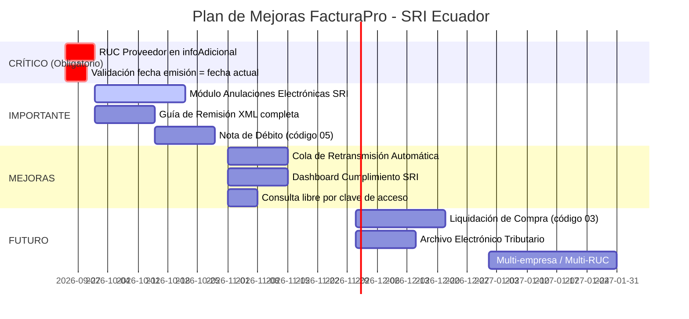

# 🇪🇨 Análisis FacturaPro vs Resoluciones SRI Ecuador (2025–2026)

> Análisis generado el **23 de septiembre de 2026** sobre la base del código fuente actual del sistema y las últimas resoluciones del SRI Ecuador.

---

## 📜 Resoluciones SRI Analizadas

| Resolución | Fecha vigencia | Descripción |
|---|---|---|
| **NAC-DGERCGC25-00000014** | 1 ago 2025 | Nuevas reglas de anulación de comprobantes electrónicos |
| **NAC-DGERCGC25-00000017** | 1 ene 2026 | Transmisión en tiempo real, sin fechas retroactivas |
| **NAC-DGERCGC26-00000027** | 28 jul 2026 | Registro de proveedores de facturación y RUC en `infoAdicional` |

---

## 🔍 Estado Actual del Sistema

### ✅ Lo que el sistema ya tiene bien

- Generación de XML firmado para: **Facturas (01), Notas de Crédito (04), Comprobantes de Retención (07)**
- Ciclo completo SRI: Generación → Firma → Recepción → Autorización
- Clave de acceso con módulo 11 correctamente implementada
- Soporte de ambientes PRUEBAS y PRODUCCIÓN
- Envío de email con XML adjunto tras autorización
- Historial de emails (`sri_email_envios`)
- Soporte RIMPE, agente de retención, contribuyente especial en XML
- Múltiples tipos de IVA (0%, 12%, 14%, 15%)
- Registro de auditoría en acciones SRI
- Guía de Remisión (RIDE service existente)

---

## 🚨 Brechas Críticas vs Resoluciones SRI 2025-2026

### 1. 🔴 CRÍTICO — Transmisión en Tiempo Real (NAC-DGERCGC25-00000017 · vigente desde ene 2026)

**Problema encontrado:** El sistema actualmente permite emitir facturas con `fecha_emision` que puede ser diferente a la fecha actual, y **no hay validación** de que la transmisión al SRI ocurra en tiempo real en el momento de emisión.

```js
// sri_utils.js — La fecha se toma del campo invoice.fecha_emision sin restricción
const claveAcceso = generarClaveAccesoSRI({
  fechaEmision: invoice.fecha_emision || new Date(), // ← podría ser retroactiva
  ...
});
```

**Lo que falta:**
- Validación backend que impida `fecha_emision` con más de **0 días de diferencia** a la fecha corriente al momento de enviar al SRI
- Bloqueo de transmisión si `fecha_emision != fecha_actual` en el endpoint `/process-test` y `/authorize-test`
- Alertas en el frontend cuando se intente emitir con fecha diferente a hoy

---

### 2. 🔴 CRÍTICO — RUC del Proveedor de Software en `infoAdicional` (NAC-DGERCGC26-00000027 · desde sep 2026)

**Problema encontrado:** El XML de facturas actualmente solo incluye Email y Teléfono en `infoAdicional`:

```js
// sri_utils.js línea 250-253
<infoAdicional>
  <campoAdicional nombre="Email">...</campoAdicional>
  <campoAdicional nombre="Telefono">...</campoAdicional>
</infoAdicional>
```

**Resolución exige:** incluir el RUC del proveedor de software (FacturaPro) en `infoAdicional` con un campo específico.

**Lo que falta:**
- Campo configurable `ruc_proveedor_software` en la tabla `empresas`
- Agregar `<campoAdicional nombre="RucProveedorSoftware">XXXXXXXXXXXXXXX</campoAdicional>` en los 3 tipos de XML (facturas, notas de crédito, retenciones)
- UI en configuración de empresa para ingresar este RUC
- **Este cambio es obligatorio** para cumplir con la normativa

---

### 3. 🟠 IMPORTANTE — Anulación Online con Plazos Restringidos (NAC-DGERCGC25-00000014)

**Problema encontrado:** El sistema tiene lógica de anulación de facturas (`estado = 'ANULADA'`), pero **no implementa el flujo oficial de anulación electrónica del SRI**:

- ❌ No hay endpoint para solicitar anulación al SRI en línea
- ❌ No se valida el plazo de **7 días del mes siguiente** para anular
- ❌ No hay flujo de **aceptación/rechazo** por parte del receptor (5 días hábiles)
- ❌ No existe restricción para anular facturas emitidas a **"Consumidor Final"**
- ❌ No se registra la solicitud de anulación en `sri_comprobantes`

**Lo que falta:**
- Nuevo estado en `sri_comprobantes`: `ANULACION_SOLICITADA`, `ANULACION_ACEPTADA`, `ANULACION_RECHAZADA`
- Validación de fecha límite (día 7 del mes siguiente)
- Integración con el WS de anulación del SRI
- Flujo de notificación al receptor

---

### 4. 🟠 IMPORTANTE — Guía de Remisión no tiene flujo SRI completo

**Problema encontrado:** El sistema tiene `ride_service.js` y una ruta `rides.js`, pero **la Guía de Remisión (código 06) no tiene su propio XML builder ni flujo SRI** en `sri_utils.js` ni en `sri.js`.

```
backend/services/ride_service.js   ← existe pero parece ser para RIDE PDF
backend/routes/rides.js            ← solo 2.248 bytes, muy básico
```

**Lo que falta:**
- `buildGuiaRemisionXml()` en `sri_utils.js`
- Endpoints SRI para guía de remisión: `/rides/:id/generate-test-xml`, `/rides/:id/process-test`
- Tabla `guias_remision` completa con campos de transporte

---

### 5. 🟡 MEJORA NECESARIA — Nota de Débito (código 05) no implementada

El sistema solo soporta: Facturas (01), Notas de Crédito (04), Retenciones (07).

**Falta completamente:**
- Módulo de Notas de Débito (código SRI 05)
- `buildNotaDebitoXml()` en `sri_utils.js`
- Rutas backend y frontend para Notas de Débito

---

### 6. 🟡 MEJORA NECESARIA — Sin consulta directa al SRI por clave de acceso

**Problema:** El sistema no tiene un endpoint de **consulta libre** por clave de acceso. Si un comprobante queda en estado intermedio, el usuario no puede consultarlo directamente.

**Lo que falta:**
- `GET /sri/consult/:claveAcceso` — consultar autorización directamente al SRI
- Botón "Re-consultar estado" en el frontend para comprobantes en estado `RECIBIDO` o `EN_PROCESO`

---

## 📦 Módulos Faltantes para un Sistema Completo

### Módulo 1: 🏷️ Liquidación de Compra (código SRI 03)
Requerida cuando se compra a personas naturales no obligadas a llevar contabilidad.
- `buildLiquidacionCompraXml()` en `sri_utils.js`
- Módulo frontend en `documents/liquidaciones/`
- Rutas backend: `liquidaciones.js`

### Módulo 2: 📦 Guía de Remisión Completa (código SRI 06)
El sistema tiene el servicio RIDE pero no el XML SRI completo.
- Constructor XML con campos: `destinatario`, `ruta`, `placa`, `fechaIniTransporte`, `fechaFinTransporte`
- Flujo completo: generar → firmar → enviar → autorizar

### Módulo 3: 📋 Nota de Débito (código SRI 05)
- Frontend: módulo `documents/debitnotes/`
- Backend: `debit_notes.js` route + `buildNotaDebitoXml()`
- Tabla `notas_debito` + `nota_debito_detalles`

### Módulo 4: 🔄 Módulo de Anulaciones Electrónicas SRI
- Panel de gestión de anulaciones con estado y plazos
- Validación automática de fecha límite (día 7 mes siguiente)
- Historial de solicitudes de anulación
- Notificación al receptor del comprobante

### Módulo 5: 📊 Dashboard de Cumplimiento SRI
- Indicadores en tiempo real de comprobantes pendientes de autorizar
- Alertas de comprobantes próximos a vencer el plazo de anulación
- Resumen de estados: GENERADO, FIRMADO, RECIBIDO, AUTORIZADO, DEVUELTO, NO_AUTORIZADO
- Gráficas por tipo de comprobante y período

### Módulo 6: 🔁 Cola de Retransmisión Automática
- Servicio de reintento automático para comprobantes en estado `RECIBIDO` pero sin autorización
- Job periódico (cron) que consulta comprobantes pendientes y re-consulta al SRI
- Configuración de reintentos máximos y backoff exponencial

### Módulo 7: 🏪 Portal del Receptor / Aceptación de Anulaciones
- Vista para que el receptor acepte o rechace solicitudes de anulación en línea
- Notificaciones por email/SMS con enlace de aceptación
- Registro de aceptaciones/rechazos en base de datos

### Módulo 8: 📁 Archivo Electrónico Tributario
- Descarga masiva de XMLs autorizados por período (mes, año)
- Generación de ZIP con XMLs y RIDEs para respaldo
- Búsqueda avanzada por número de autorización, RUC comprador, rango de montos

### Módulo 9: 🧾 Comprobantes de Retención Automáticos (para compras)
- Generación automática del comprobante de retención al registrar una compra
- Aplicación automática de porcentajes según tipo de proveedor y bien/servicio
- Tabla de tarifas de retención actualizable (Renta e IVA)

### Módulo 10: 🌐 Multi-empresa / Multi-RUC
- Soporte para gestionar varias empresas desde el mismo sistema
- Certificados digitales independientes por empresa
- Secuenciales y series independientes por empresa

---

## 🗺️ Plan de Mejoras Priorizado



---

## ⚡ Cambios de Código Inmediatos (Semana 1)

### Cambio 1: RUC del Proveedor en XML (URGENTE)

**Archivo:** [`sri_utils.js`](file:///c:/Cursos/facturapro/backend/utils/sri_utils.js#L250-L253)

```js
// ANTES (líneas 250-253)
<infoAdicional>
  <campoAdicional nombre="Email">${escapeXml(invoice.cliente_email)}</campoAdicional>
  <campoAdicional nombre="Telefono">${escapeXml(invoice.cliente_telefono)}</campoAdicional>
</infoAdicional>

// DESPUÉS — agregar campo RUC del proveedor
<infoAdicional>
  <campoAdicional nombre="Email">${escapeXml(invoice.cliente_email)}</campoAdicional>
  <campoAdicional nombre="Telefono">${escapeXml(invoice.cliente_telefono)}</campoAdicional>
  ${company.ruc_proveedor_software
    ? `<campoAdicional nombre="RucProveedorSoftware">${escapeXml(company.ruc_proveedor_software)}</campoAdicional>`
    : ''}
</infoAdicional>
```

### Cambio 2: Validación de Fecha en Tiempo Real

**Archivo:** [`sri.js`](file:///c:/Cursos/facturapro/backend/routes/sri.js#L1048-L1060)

```js
// Agregar en el endpoint /process-test antes de buildFacturaXml()
const today = new Date().toISOString().split('T')[0];
const emisionDate = new Date(invoice.fecha_emision).toISOString().split('T')[0];
if (emisionDate !== today) {
  throw new Error(
    `NAC-DGERCGC25-00000017: La fecha de emisión (${emisionDate}) debe ser la fecha actual (${today}). No se permiten comprobantes con fecha retroactiva.`
  );
}
```

### Cambio 3: Migración de BD para ruc_proveedor_software

```sql
-- Nueva migración: migrate_phase22_sri_provider.js
ALTER TABLE empresas
  ADD COLUMN IF NOT EXISTS ruc_proveedor_software VARCHAR(13);

COMMENT ON COLUMN empresas.ruc_proveedor_software
  IS 'RUC del proveedor de software de facturación (NAC-DGERCGC26-00000027)';
```

---

## 📋 Resumen Ejecutivo

| Área | Estado | Prioridad |
|---|---|---|
| RUC proveedor en XML | ❌ Faltante | 🔴 Inmediato |
| Fecha emisión tiempo real | ❌ Sin validación | 🔴 Inmediato |
| Anulaciones online SRI | ❌ No implementado | 🟠 Urgente |
| Nota de Débito (05) | ❌ No existe | 🟠 Urgente |
| Guía de Remisión XML | ⚠️ Incompleta | 🟠 Urgente |
| Cola retransmisión auto | ❌ No existe | 🟡 Importante |
| Dashboard cumplimiento | ❌ No existe | 🟡 Importante |
| Liquidación de Compra (03) | ❌ No existe | 🟡 Mediano plazo |
| Portal receptor anulaciones | ❌ No existe | 🟡 Mediano plazo |
| Multi-empresa | ❌ No existe | ⚪ Largo plazo |

> [!CAUTION]
> Los cambios marcados como 🔴 **Inmediato** son obligatorios por normativa vigente. El incumplimiento puede generar multas tributarias al contribuyente y a FacturaPro como proveedor de software.

> [!TIP]
> Comenzar por el **Cambio 1 (RUC proveedor en XML)** es la tarea de menor esfuerzo y mayor impacto normativo. Solo requiere modificar 3 funciones en `sri_utils.js` y agregar un campo en la tabla `empresas`.
