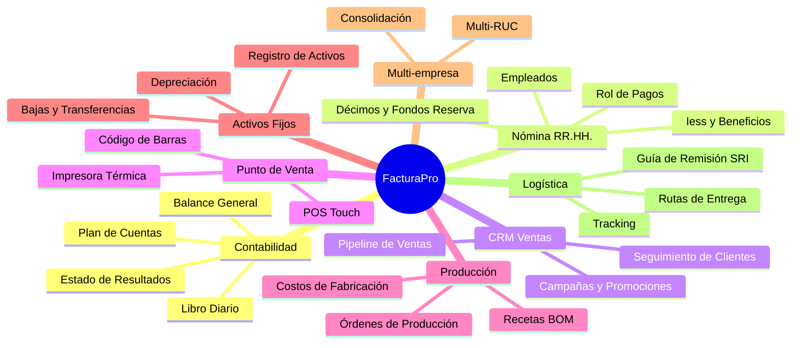
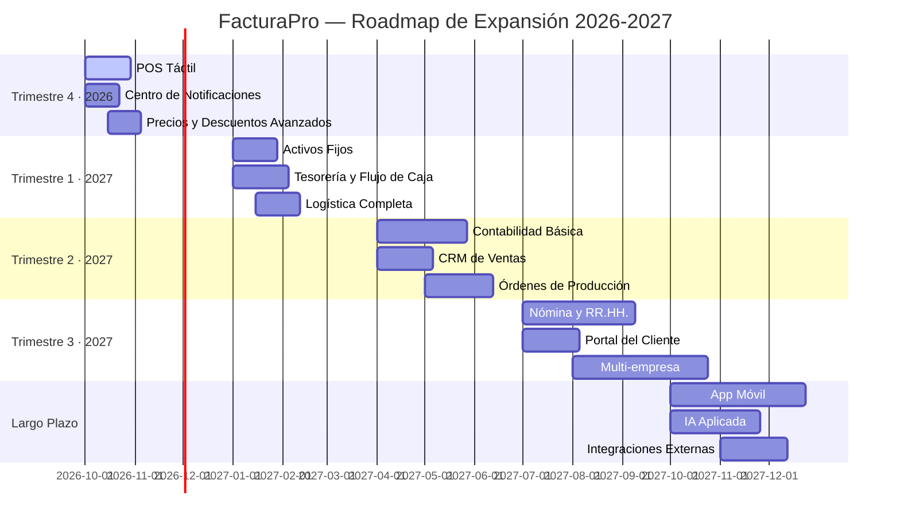

# 🚀 FacturaPro — Mapa de Expansión del Sistema

> Análisis generado el 23 de septiembre de 2026 sobre el código fuente actual.

---

## 📦 Lo que ya tienes hoy (inventario real del código)

| Módulo | Estado | Archivos clave |
|---|---|---|
| **Autenticación / Roles / Permisos** | ✅ Completo | `auth.js` |
| **Empresa y Sucursales** | ✅ Completo | `company.js`, `branches.js` |
| **Clientes** | ✅ Completo | `clients.js` |
| **Proveedores** | ✅ Completo | `suppliers.js` |
| **Productos y Categorías** | ✅ Completo | `products.js`, `categories.js` |
| **Inventario + Kardex valorizado** | ✅ Completo | `inventory.js`, `inventory_costing.js` |
| **Cotizaciones / Proformas** | ✅ Completo | `proformas.js` |
| **Facturas de Venta** | ✅ Completo | `invoices.js` |
| **Notas de Crédito** | ✅ Completo | `credit_notes.js` |
| **Comprobantes de Retención** | ✅ Completo | `withholdings.js` |
| **Compras / Cuentas por Pagar** | ✅ Completo | `purchases.js` |
| **Cuentas por Cobrar + Cobranza** | ✅ Completo | `invoices.js` (receivables) |
| **Caja / Sesiones de Caja** | ✅ Completo | `cash_registers.js` |
| **Bancos** | ✅ Presente | `banks.js` |
| **Facturación Electrónica SRI** | ✅ Parcial | `sri.js`, `sri_utils.js` |
| **RIDE / PDF de comprobantes** | ✅ Presente | `ride_service.js` |
| **Reportes / Dashboard** | ✅ Básico | `reports.js`, `ReportsDashboard.jsx` |
| **Auditoría** | ✅ Completo | `audit.js` |
| **Email de comprobantes** | ✅ Completo | `email_service.js` |
| **Secuenciales** | ✅ Completo | `sequentials.js` |

---

## 🗺️ Mapa de Expansión — 15 Módulos Recomendados



---

## 📋 Los 15 Módulos en Detalle

---

### 🥇 PRIORIDAD ALTA — Alto valor, lógica conectada con lo existente

---

#### 1. 🏪 Punto de Venta (POS) con Pantalla Táctil

**¿Por qué?** Ya tienes cajas, inventario y facturación. El POS es la capa visual que los une para ventas rápidas en mostrador.

**Qué incluye:**
- Pantalla de cobro táctil con búsqueda de productos por código de barras, nombre o categoría
- Cálculo de cambio automático (efectivo, tarjeta, mixto)
- Impresión automática de factura/ticket en impresora térmica (80mm)
- Cierre automático al cuadrar la caja
- Modo sin internet (offline) con sincronización posterior

**Stack sugerido:**
```
Frontend:  Componente POS fullscreen (React)
Backend:   Reutiliza /api/invoices + /api/cash-registers
Nuevo:     Soporte WebSocket para actualizar stock en tiempo real
```

**Tablas nuevas:** `pos_configuracion`, `pos_tickets_impresos`
**Complejidad:** 🟡 Media (3–4 semanas)
**Valor comercial:** ⭐⭐⭐⭐⭐ Muy alto — diferenciador frente a competidores

---

#### 2. 📒 Contabilidad Básica (Plan de Cuentas + Diario)

**¿Por qué?** Toda operación que ya registras (ventas, compras, cobros, pagos) puede generar asientos contables automáticamente.

**Qué incluye:**
- Plan de cuentas configurable (basado en NIC para Ecuador)
- Asientos contables automáticos por cada: factura, compra, cobro, pago, retención
- Libro diario y mayor general
- Balance General y Estado de Resultados
- Conciliación bancaria básica

**Stack sugerido:**
```
Backend:  plan_cuentas, asientos_contables, asiento_detalles
Trigger:  Hooks automáticos al emitir/cobrar facturas
```

**Tablas nuevas:** `plan_cuentas`, `asientos_contables`, `asiento_detalles`, `ejercicios_fiscales`
**Complejidad:** 🔴 Alta (6–8 semanas)
**Valor comercial:** ⭐⭐⭐⭐⭐ Muy alto — convierte el sistema en ERP completo

---

#### 3. 👨‍💼 Nómina y Recursos Humanos

**¿Por qué?** Es el módulo más demandado en Ecuador junto con facturación electrónica.

**Qué incluye:**
- Registro de empleados con datos personales, cargo, sueldo, banco
- Cálculo automático del Rol de Pagos mensual
- Décimo tercero, décimo cuarto sueldo
- Fondos de reserva IESS
- Utilidades
- Generación del archivo de aviso de entrada/salida IESS
- Reportes para el SRI (Anexo de Relación de Dependencia)

**Tablas nuevas:** `empleados`, `contratos`, `roles_pago`, `rol_pago_detalles`, `beneficios_sociales`
**Complejidad:** 🔴 Alta (8–10 semanas)
**Valor comercial:** ⭐⭐⭐⭐⭐ Muy alto — nuevo segmento de clientes

---

#### 4. 🏭 Activos Fijos y Depreciación

**¿Por qué?** Obligatorio para empresas que declaran impuesto a la renta. Se conecta directamente con contabilidad y compras.

**Qué incluye:**
- Registro de activos fijos con: código, descripción, fecha compra, valor, vida útil
- Cálculo automático de depreciación (línea recta y acelerada)
- Cuadro de depreciación anual
- Bajas y transferencias de activos
- Reporte para Formulario 101 SRI

**Tablas nuevas:** `activos_fijos`, `depreciaciones`, `bajas_activos`
**Complejidad:** 🟡 Media (3–4 semanas)
**Valor comercial:** ⭐⭐⭐⭐ Alto — obligatorio para muchos contribuyentes

---

#### 5. 🔔 Centro de Notificaciones y Alertas Inteligentes

**¿Por qué?** Ya tienes los datos; solo falta un sistema que los convierta en alertas accionables.

**Qué incluye:**
- Alertas de stock bajo (ya tienes la query, falta la notificación push)
- Facturas por vencer en X días (para cobranza proactiva)
- Comprobantes SRI pendientes de autorización
- Vencimiento del certificado digital
- Cuotas de pago por vencer (cuentas por pagar)
- Notificaciones por email, WhatsApp Business API y push en navegador

**Stack sugerido:**
```
Backend:  Cron job diario (node-cron) + tabla notificaciones
Frontend: Panel de notificaciones + badges
Externo:  WhatsApp Business API (Meta) o Twilio
```

**Tablas nuevas:** `notificaciones`, `notificacion_configuracion`
**Complejidad:** 🟢 Baja–Media (2–3 semanas)
**Valor comercial:** ⭐⭐⭐⭐ Alto — mejora experiencia de uso drásticamente

---

### 🥈 PRIORIDAD MEDIA — Valor alto, complejidad manejable

---

#### 6. 📊 CRM — Gestión de Clientes y Ventas

**¿Por qué?** Tienes clientes pero no puedes hacer seguimiento comercial. El CRM añade el pipeline de ventas.

**Qué incluye:**
- Pipeline de oportunidades de venta (Kanban: Prospecto → Cotización → Negociación → Ganado/Perdido)
- Historial de interacciones por cliente (llamadas, emails, visitas)
- Campañas de email marketing básico (integración con Brevo/Mailchimp)
- Segmentación de clientes por volumen de compra, zona, categoría
- Recordatorios y tareas de seguimiento

**Tablas nuevas:** `oportunidades`, `interacciones_cliente`, `campanas_marketing`, `segmentos_clientes`
**Complejidad:** 🟡 Media (4–5 semanas)
**Valor comercial:** ⭐⭐⭐⭐ Alto — diferenciador para empresas con fuerza de ventas

---

#### 7. 🏭 Órdenes de Producción (Manufactura Básica)

**¿Por qué?** Negocios que fabrican necesitan convertir materias primas en productos terminados.

**Qué incluye:**
- Recetas / BOM (Bill of Materials): qué insumos necesita cada producto
- Órdenes de producción con estado: Pendiente → En Proceso → Terminada
- Descuento automático de insumos del inventario al producir
- Ingreso automático del producto terminado al inventario
- Costo de producción por lote

**Tablas nuevas:** `recetas`, `receta_insumos`, `ordenes_produccion`, `produccion_detalles`
**Complejidad:** 🟡 Media (4–6 semanas)
**Valor comercial:** ⭐⭐⭐⭐ Alto — abre mercado de manufactura/alimentos/industria

---

#### 8. 🚚 Logística y Guías de Remisión Completas

**¿Por qué?** Tienes el RIDE de guía de remisión pero sin flujo SRI ni módulo de rutas.

**Qué incluye:**
- Registro completo de guías de remisión (XML SRI código 06)
- Gestión de transportistas y vehículos
- Rutas de entrega con estado (Pendiente → En ruta → Entregado)
- Firma del receptor digital o manual
- Tracking básico por guía

**Tablas nuevas:** `transportistas`, `vehiculos`, `rutas_entrega`, `guias_remision` (expandida)
**Complejidad:** 🟡 Media (3–4 semanas)
**Valor comercial:** ⭐⭐⭐ Medio–Alto — esencial para distribuidoras

---

#### 9. 💰 Tesorería y Flujo de Caja

**¿Por qué?** Tienes cuentas bancarias pero no proyección de flujo de caja.

**Qué incluye:**
- Conciliación bancaria (importación de estados de cuenta CSV/OFX)
- Proyección de flujo de caja a 30/60/90 días
- Programación de pagos a proveedores
- Dashboard financiero: disponible, por cobrar, por pagar, flujo neto
- Transferencias entre cuentas bancarias

**Tablas nuevas:** `movimientos_bancarios`, `conciliaciones`, `proyeccion_flujo`
**Complejidad:** 🟡 Media (4–5 semanas)
**Valor comercial:** ⭐⭐⭐⭐ Alto — crítico para gerentes financieros

---

#### 10. 🎁 Gestión de Precios y Descuentos Avanzados

**¿Por qué?** Hoy el precio es fijo por producto. Los negocios necesitan precios dinámicos.

**Qué incluye:**
- Listas de precios por cliente, zona o segmento
- Descuentos automáticos por volumen (escalonados)
- Promociones temporales (precio especial del 1 al 15 de cada mes)
- Precio especial por cliente VIP
- Precio con o sin IVA configurable por lista

**Tablas nuevas:** `listas_precios`, `lista_precio_detalles`, `promociones`, `descuentos_volumen`
**Complejidad:** 🟢 Baja–Media (2–3 semanas)
**Valor comercial:** ⭐⭐⭐⭐ Alto — muy demandado en retail y distribución

---

### 🥉 PRIORIDAD MEDIA-BAJA — Expansión futura

---

#### 11. 🌐 Portal del Cliente (Self-Service)

**Qué incluye:**
- Acceso web del cliente para: ver sus facturas, descargar XMLs y PDFs, consultar saldo, hacer pagos en línea (Payphone, PayPal)
- Historial de compras y estado de pedidos
- Aprobación de anulaciones de comprobantes (flujo SRI 2025)

**Complejidad:** 🟡 Media (4–5 semanas)
**Valor comercial:** ⭐⭐⭐ Medio — diferenciador premium

---

#### 12. 📱 App Móvil (PWA o React Native)

**Qué incluye:**
- Versión móvil del POS para vendedores en campo
- Escaneo de código de barras con cámara
- Consulta de stock, clientes y facturas
- Notificaciones push

**Complejidad:** 🔴 Alta (8–12 semanas)
**Valor comercial:** ⭐⭐⭐ Medio — diferenciador en B2B

---

#### 13. 🏢 Multi-empresa / Multi-RUC

**Qué incluye:**
- Gestión de varias empresas desde un solo sistema
- Bases de datos separadas o esquemas independientes por empresa
- Consolidación de reportes entre empresas relacionadas
- Facturación cruzada entre empresas del mismo grupo

**Complejidad:** 🔴 Muy alta (10–16 semanas, requiere refactoring arquitectural)
**Valor comercial:** ⭐⭐⭐⭐ Alto — abre mercado de grupos empresariales

---

#### 14. 🤖 Inteligencia Artificial Aplicada

**Qué incluye:**
- Predicción de demanda de productos basada en histórico de ventas
- Recomendación de reorden de inventario
- Detección de anomalías en facturación (posibles fraudes)
- Chatbot de consultas básicas (saldo de cliente, estado de factura)
- Clasificación automática de gastos (OCR de facturas de compra)

**Complejidad:** 🔴 Alta (varía por feature)
**Valor comercial:** ⭐⭐⭐⭐ Alto — diferenciador tecnológico fuerte

---

#### 15. 📤 Integraciones con Plataformas Externas

**Qué incluye:**
- **E-commerce:** Sincronización de pedidos desde WooCommerce, Shopify, TiendaNube
- **Marketplaces:** Amazon, MercadoLibre (sincronización de inventario y ventas)
- **Plataformas contables:** Exportación a Monica, ContaPlus, Defontana
- **Pasarelas de pago:** Payphone Ecuador, PayPal, Stripe
- **IESS:** Generación de avisos de entrada/salida y planillas

**Complejidad:** 🟡–🔴 Variable
**Valor comercial:** ⭐⭐⭐⭐⭐ Muy alto — ecosistema completo

---

## 🗓️ Roadmap Recomendado



---

## 💡 Top 3 para empezar HOY

| # | Módulo | Por qué empezar aquí |
|---|---|---|
| **1** | 🏪 **POS Táctil** | Reutiliza todo lo que ya existe. Solo requiere UI y un par de endpoints nuevos. ROI inmediato. |
| **2** | 🔔 **Centro de Notificaciones** | Bajo esfuerzo, altísimo impacto en UX. Se construye sobre queries que ya tienes en `reports.js`. |
| **3** | 💰 **Precios y Descuentos Avanzados** | Feature muy pedido en retail y distribución. Cambia solo la lógica de precio al facturar. |

---

## 🏗️ Arquitectura Técnica para Escalar

Dado que el sistema ya usa **Express + PostgreSQL + React**, estos son los componentes técnicos a añadir para soportar los módulos nuevos:

```
┌─────────────────────────────────────────────────┐
│                   FRONTEND                       │
│  React + CoreUI + Zustand (estado global)        │
│  PWA → App Móvil (React Native Web)             │
└─────────────────────┬───────────────────────────┘
                      │ REST + WebSocket
┌─────────────────────▼───────────────────────────┐
│                    BACKEND                       │
│  Express.js (ya existe)                          │
│  + node-cron   → Notificaciones / Retransmisión  │
│  + ws / socket.io → POS en tiempo real           │
│  + bull/bullmq → Cola de trabajos async          │
│  + pdfkit (ya existe) → PDF nómina, activos      │
└─────────────────────┬───────────────────────────┘
                      │
┌─────────────────────▼───────────────────────────┐
│                  BASE DE DATOS                   │
│  PostgreSQL (ya existe)                          │
│  + Esquemas separados por módulo                 │
│  + Particionado de tablas grandes (movimientos)  │
│  + Redis → Caché de reportes + sesiones POS      │
└─────────────────────────────────────────────────┘
```

> [!TIP]
> Agregar **Redis** es el próximo paso de infraestructura más impactante. Te permite cachear reportes pesados, manejar sesiones POS distribuidas y procesar trabajos en segundo plano (colas de email, notificaciones, retransmisión SRI).
